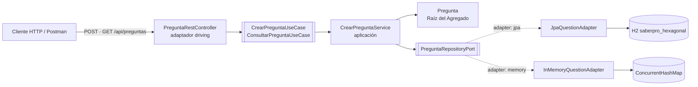
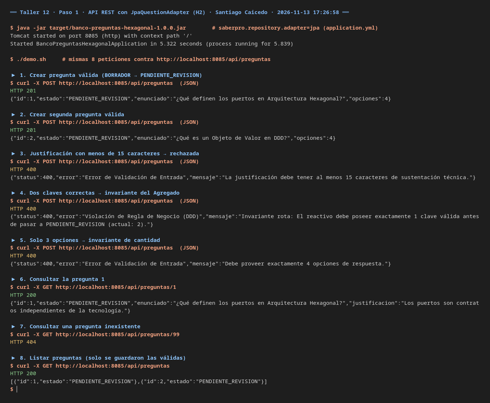
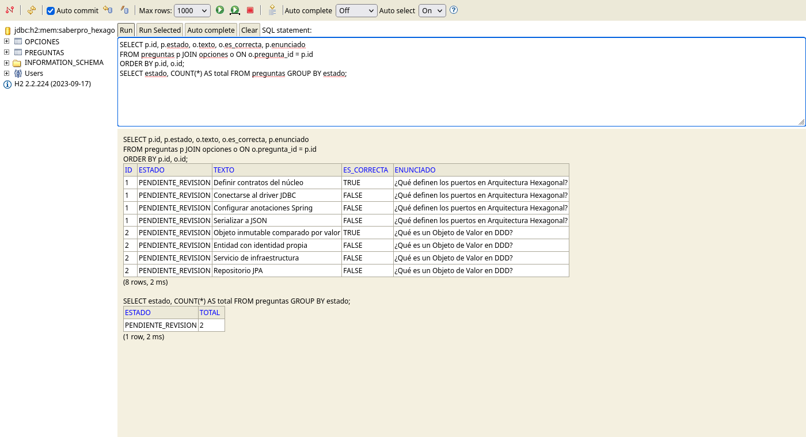
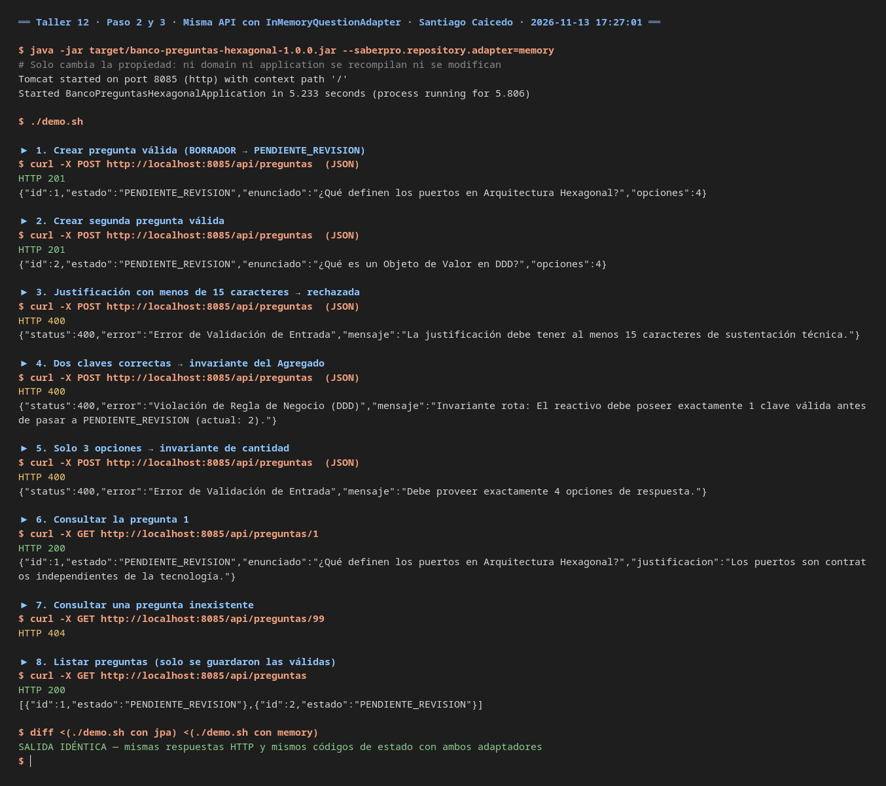
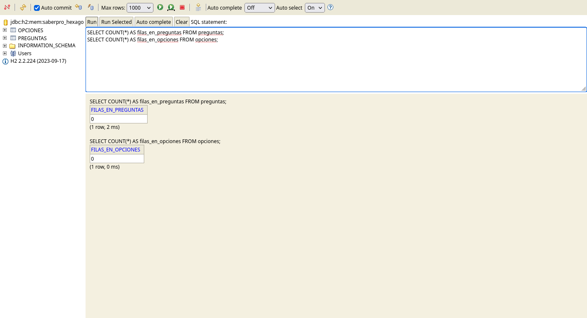
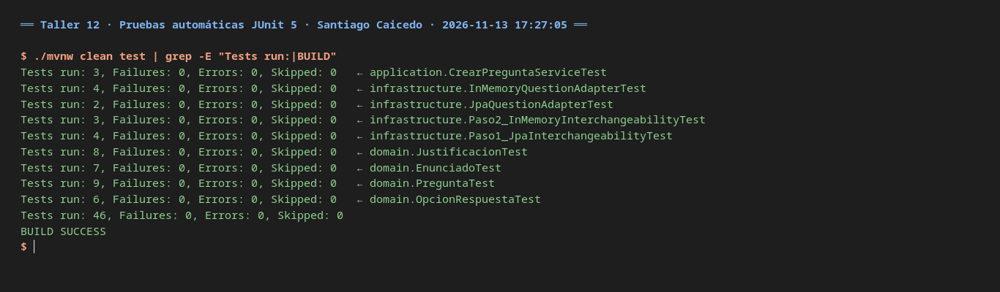
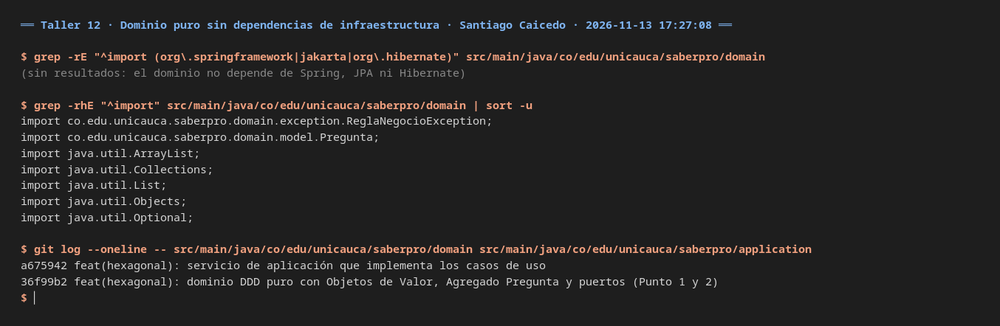
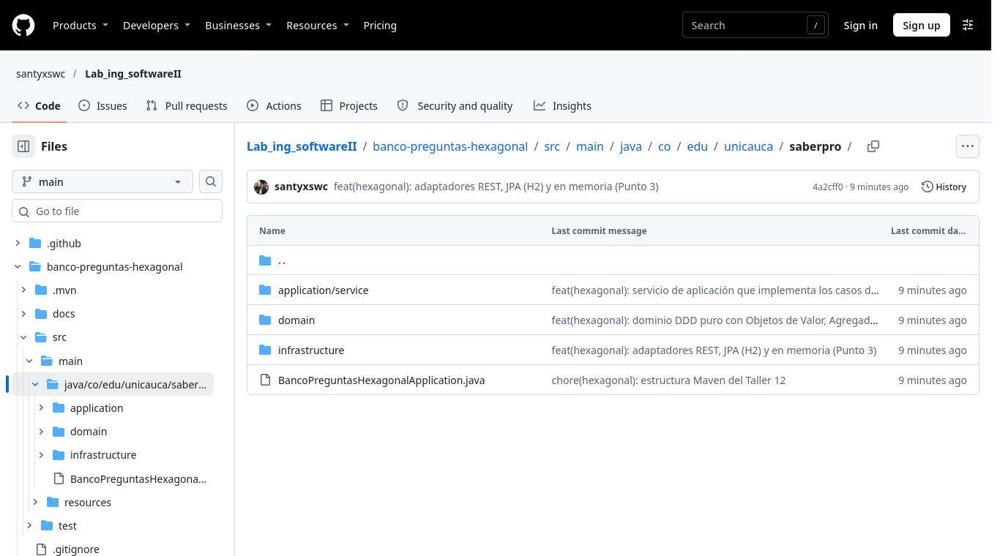
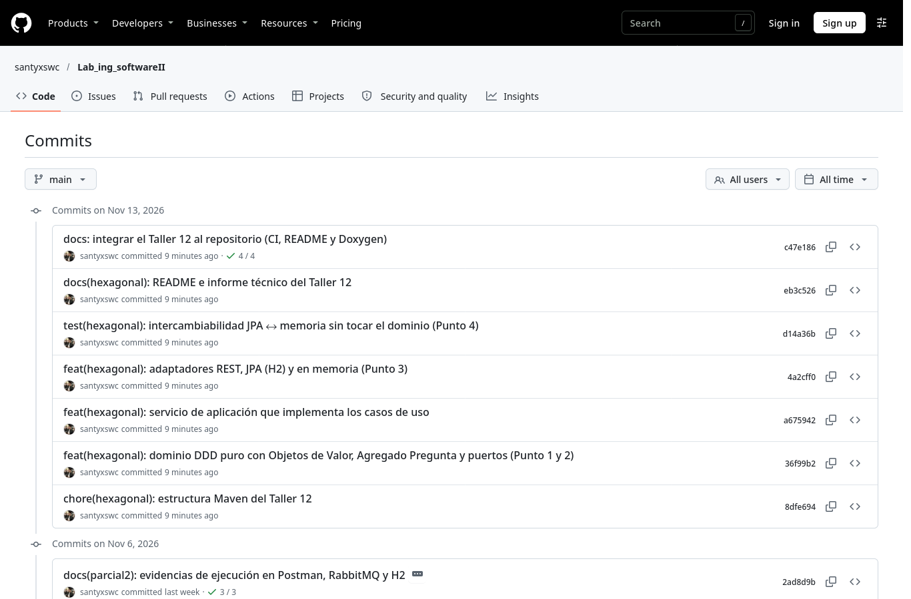
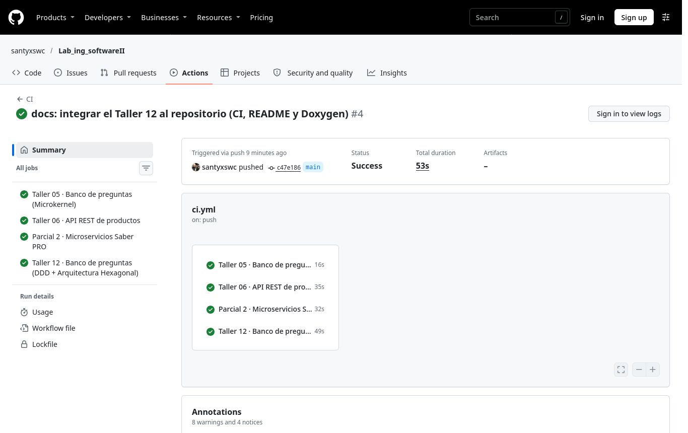

# Banco de Preguntas Saber PRO — Taller 12 (Arquitectura Hexagonal y DDD, Fase I)

**Laboratorio de Ingeniería de Software II — Universidad del Cauca — 2026.2**

**Docente:** Ing. Paola Andrea Bedoya Toro · **Autores:** Santiago Caicedo, Adrian Araujo, Ivan Alexander López · [Informe técnico (Word)](docs/Formato-Documento.docx) · [Ver evidencias de ejecución](#10-evidencias-de-ejecución)

Núcleo de creación y evaluación de reactivos del Banco Saber PRO modelado con **DDD táctico** y aislado del
mundo exterior con **Arquitectura Hexagonal (Puertos y Adaptadores)**. La persistencia se puede cambiar entre
JPA (H2) y memoria (`ConcurrentHashMap`) sin tocar una sola línea del dominio ni de la aplicación.

| Punto del taller | Qué se pide | Dónde está |
|---|---|---|
| **1** Modelo DDD puro | Objetos de Valor inmutables, Raíz del Agregado e invariantes | `domain/model/` (`Enunciado`, `Justificacion`, `OpcionRespuesta`, `Pregunta`) |
| **2** Puertos | Casos de uso (entrada) y persistencia (salida) | `domain/ports/inbound/`, `domain/ports/outbound/` |
| **3** Adaptadores | REST (driving) y persistencia JPA / memoria (driven) | `infrastructure/adapters/` |
| **4** Intercambiabilidad | Cambiar `JpaQuestionAdapter` por `InMemoryQuestionAdapter` | `infrastructure/config/RepositoryAdapterConfig.java`, `application.yml` |
| **5** Informe y pruebas | Informe técnico y suite automática | [`docs/Formato-Documento.docx`](docs/Formato-Documento.docx), [`docs/INFORME_TECNICO.md`](docs/INFORME_TECNICO.md), `src/test/` (46 pruebas) |

---

## 1. Arquitectura



```
                           HEXÁGONO (NÚCLEO)
    +-------------------------------------------------------------+
    |                    CAPA DE DOMINIO (DDD)                    |
    |                                                             |
    |   +-------------------+          +----------------------+   |
    |   | PUERTO ENTRADA    |          | PUERTO SALIDA        |   |
    |   | (Inbound Driving) |          | (Outbound Driven)    |   |
    |   |                   |          |                      |   |
    |   |CrearPregunta-     |          |PreguntaRepositoryPort|   |
    |   |UseCase            |          +----------+-----------+   |
    |   +---------+---------+                     ^               |
    |             ^                               |               |
    |             |                               |               |
    |   +---------+-------------------------------+-----------+   |
    |   |                   AGREGADO: Pregunta                |   |
    |   |                                                     |   |
    |   |  - Enunciado (VO)        - Opciones (4 VOs)         |   |
    |   |  - Justificacion (VO)    - Estado (BORRADOR ->      |   |
    |   |                            PENDIENTE_REVISION)      |   |
    |   |  * Invariantes de Negocio estrictas                 |   |
    |   +-----------------------------------------------------+   |
    +-------------------------------------------------------------+
               ^                                  |
               |                                  |
+--------------+---------------+   +--------------+---------------+
|       ADAPTADOR DRIVING      |   |       ADAPTADORES DRIVEN     |
|   PreguntaRestController     |   |  (Intercambiables sin tocar  |
|         (HTTP / REST)        |   |           el dominio)        |
+------------------------------+   +------------------------------+
                                   | a) JpaQuestionAdapter (H2)   |
                                   | b) InMemoryQuestionAdapter   |
                                   +------------------------------+
```

La regla de dependencia apunta siempre hacia adentro: `infrastructure → application → domain`. El paquete
`domain` solo importa clases de `java.util` y de sí mismo; no conoce Spring, JPA, Hibernate, H2 ni HTTP.

---

## 2. Modelo DDD puro (Punto 1)

### 2.1 Objetos de Valor inmutables

| Objeto de Valor | Tipo | Regla | Si no se cumple |
|---|---|---|---|
| `Enunciado` | `record` | No nulo ni vacío después de `trim()` | `ReglaNegocioException` |
| `Justificacion` | `record` | Al menos **15 caracteres** de sustentación técnica | `ReglaNegocioException` |
| `OpcionRespuesta` | `record` | Texto no nulo ni vacío y bandera `esCorrecta` | `ReglaNegocioException` |

Al ser `record`, dos objetos con los mismos valores son iguales (`equals`/`hashCode` por valor) y no exponen setters.

### 2.2 Raíz del Agregado: `Pregunta`

- **Encapsulamiento:** guarda el identificador, el enunciado, la justificación, las opciones y el estado.
  `getOpciones()` devuelve una lista inmodificable (`Collections.unmodifiableList`).
- **Invariantes:**
  1. Exactamente **4 opciones** de respuesta.
  2. Exactamente **1 clave correcta**.
- **Ciclo de vida:** se crea con `Pregunta.crearBorrador(...)` en estado `BORRADOR` y con identificador nulo.
  `enviarARevision()` valida las invariantes y, si se cumplen, pasa a `PENDIENTE_REVISION`; si no, lanza
  `ReglaNegocioException` y el estado no cambia.

---

## 3. Puertos y adaptadores (Puntos 2 y 3)

| Componente | Tipo hexagonal | Paquete | Responsabilidad |
|---|---|---|---|
| `CrearPreguntaUseCase` | Puerto de entrada (driving) | `domain.ports.inbound` | Crear una pregunta y enviarla a revisión a partir de un `CrearPreguntaCommand`. |
| `ConsultarPreguntaUseCase` | Puerto de entrada (driving) | `domain.ports.inbound` | Consultar una pregunta por id o listarlas todas. |
| `PreguntaRepositoryPort` | Puerto de salida (driven) | `domain.ports.outbound` | Operaciones puras de persistencia: `save`, `findById`, `findAll`. |
| `CrearPreguntaService` | Servicio de aplicación | `application.service` | Implementa ambos casos de uso: construye los VOs, crea el agregado, ejecuta `enviarARevision()` y delega en el puerto de salida. |
| `PreguntaRestController` | Adaptador de entrada (REST) | `infrastructure.adapters.inbound.rest` | Expone `/api/preguntas` y traduce DTOs ↔ comandos del dominio. |
| `RestExceptionHandler` | Adaptador de entrada (REST) | `infrastructure.adapters.inbound.rest` | Convierte `ReglaNegocioException` y errores de validación en `400 Bad Request`. |
| `JpaQuestionAdapter` | Adaptador de salida (JPA) | `infrastructure.adapters.outbound.persistence.jpa` | Persistencia relacional con Spring Data JPA sobre H2, usando entidades `@Entity` separadas y `PreguntaJpaMapper`. |
| `InMemoryQuestionAdapter` | Adaptador de salida (memoria) | `infrastructure.adapters.outbound.persistence.memory` | Persistencia en `ConcurrentHashMap` con generador atómico de ids. |
| `RepositoryAdapterConfig` | Configuración | `infrastructure.config` | Decide qué adaptador se inyecta en `PreguntaRepositoryPort`. |

El modelo de dominio no lleva anotaciones JPA: el adaptador JPA trabaja con `PreguntaEntity` (tabla `preguntas`) y
`OpcionEntity` (tabla `opciones`, relación `@OneToMany(cascade = ALL, orphanRemoval = true)`), y `PreguntaJpaMapper`
convierte en ambos sentidos.

---

## 4. Estructura de paquetes

```
co.edu.unicauca.saberpro
├── BancoPreguntasHexagonalApplication.java
├── domain                           <-- Núcleo puro (sin dependencias externas)
│   ├── exception
│   │   └── ReglaNegocioException.java
│   ├── model
│   │   ├── Enunciado.java           (VO inmutable)
│   │   ├── EstadoPregunta.java      (BORRADOR, PENDIENTE_REVISION)
│   │   ├── Justificacion.java       (VO >= 15 caracteres)
│   │   ├── OpcionRespuesta.java     (VO inmutable)
│   │   └── Pregunta.java            (Raíz del Agregado)
│   └── ports
│       ├── inbound
│       │   ├── ConsultarPreguntaUseCase.java
│       │   ├── CrearPreguntaCommand.java
│       │   └── CrearPreguntaUseCase.java
│       └── outbound
│           └── PreguntaRepositoryPort.java
│
├── application                      <-- Orquestación de casos de uso
│   └── service
│       └── CrearPreguntaService.java
│
└── infrastructure                   <-- Adaptadores y frameworks
    ├── adapters
    │   ├── inbound/rest             (Driving: controlador REST y DTOs)
    │   │   ├── PreguntaRestController.java
    │   │   ├── RestExceptionHandler.java
    │   │   └── dto/ (CrearPreguntaRequest, PreguntaResponse, OpcionResponse, ErrorResponse)
    │   └── outbound/persistence     (Driven: adaptadores de persistencia)
    │       ├── jpa/
    │       │   ├── JpaQuestionAdapter.java
    │       │   ├── entity/ (PreguntaEntity, OpcionEntity)
    │       │   ├── mapper/ (PreguntaJpaMapper)
    │       │   └── repository/ (SpringDataPreguntaRepository)
    │       └── memory/
    │           └── InMemoryQuestionAdapter.java
    └── config
        └── RepositoryAdapterConfig.java
```

---

## 5. Experimento de intercambiabilidad (Punto 4)

### Paso 1 — `JpaQuestionAdapter` (por defecto)

```yaml
# src/main/resources/application.yml
saberpro:
  repository:
    adapter: jpa
```

`RepositoryAdapterConfig` registra `JpaQuestionAdapter` con `@ConditionalOnProperty(havingValue = "jpa", matchIfMissing = true)`.
Al crear una pregunta con `POST /api/preguntas` los datos quedan en las tablas `preguntas` y `opciones` de H2.

### Paso 2 — Cambiar a `InMemoryQuestionAdapter`

Basta con cambiar la propiedad (no se recompila nada del núcleo):

```yaml
saberpro:
  repository:
    adapter: memory
```

También se puede pasar al arrancar: `./mvnw spring-boot:run -Dspring-boot.run.arguments=--saberpro.repository.adapter=memory`.

### Paso 3 — Mismo comportamiento sin tocar el dominio

| Prueba | Adaptador activo | Verifica |
|---|---|---|
| `Paso1_JpaInterchangeabilityTest` | `JpaQuestionAdapter` | Bean inyectado, `201 Created` con `PENDIENTE_REVISION`, `400` por justificación corta y por dos claves correctas. |
| `Paso2_InMemoryInterchangeabilityTest` | `InMemoryQuestionAdapter` | Bean inyectado, mismo `201 Created` y mismas validaciones `400`. |

**Resultado:** ambas pruebas obtienen las mismas respuestas HTTP y los mismos códigos de estado **sin modificar
ninguna línea de los paquetes `domain` ni `application`**.

---

## 6. Cómo ejecutarlo

### Requisitos

- Java 21
- Maven 3.9 o superior (o el wrapper `./mvnw` incluido)

### 6.1 Compilar y probar

```bash
cd banco-preguntas-hexagonal
./mvnw clean test          # 46 pruebas JUnit 5
```

### 6.2 Arrancar la API

```bash
./mvnw spring-boot:run     # API en http://localhost:8085/api/preguntas
```

Consola H2: `http://localhost:8085/h2-console` (JDBC URL `jdbc:h2:mem:saberpro_hexagonal`, usuario `sa`, contraseña vacía).

Si el puerto 8085 está ocupado: `SERVER_PORT=8086 ./mvnw spring-boot:run`.

### 6.3 Recorrido completo de la API

```bash
./scripts/demo.sh         # 8 peticiones: 201, 400 por reglas de negocio, 200 y 404 (requiere jq)
```

### 6.4 Ejemplo con curl

```bash
curl -X POST http://localhost:8085/api/preguntas \
  -H "Content-Type: application/json" \
  -d '{
    "enunciado": "¿Cuál es la función de los Puertos en Arquitectura Hexagonal?",
    "justificacion": "Los puertos definen contratos independientes de cualquier tecnología externa.",
    "opciones": [
      { "texto": "Definir interfaces abstractas de comunicación con el núcleo", "esCorrecta": true },
      { "texto": "Conectarse directamente con el driver JDBC", "esCorrecta": false },
      { "texto": "Configurar las anotaciones de Spring Boot", "esCorrecta": false },
      { "texto": "Serializar objetos a formato JSON", "esCorrecta": false }
    ]
  }'
```

**Respuesta `201 Created`** (cabecera `Location: /api/preguntas/1`):

```json
{
  "id": 1,
  "enunciado": "¿Cuál es la función de los Puertos en Arquitectura Hexagonal?",
  "justificacion": "Los puertos definen contratos independientes de cualquier tecnología externa.",
  "estado": "PENDIENTE_REVISION",
  "opciones": [
    { "texto": "Definir interfaces abstractas de comunicación con el núcleo", "esCorrecta": true },
    { "texto": "Conectarse directamente con el driver JDBC", "esCorrecta": false },
    { "texto": "Configurar las anotaciones de Spring Boot", "esCorrecta": false },
    { "texto": "Serializar objetos a formato JSON", "esCorrecta": false }
  ]
}
```

**Respuesta `400 Bad Request`** (por ejemplo, dos claves correctas):

```json
{
  "timestamp": "2026-11-13T17:20:00",
  "status": 400,
  "error": "Violación de Regla de Negocio (DDD)",
  "mensaje": "…",
  "ruta": "/api/preguntas"
}
```

---

## 7. Endpoints

| Método | Ruta | Descripción | Respuesta |
|---|---|---|---|
| POST | `/api/preguntas` | Crea la pregunta y la envía a revisión (`BORRADOR → PENDIENTE_REVISION`) | 201 / 400 |
| GET | `/api/preguntas` | Lista las preguntas del adaptador activo | 200 |
| GET | `/api/preguntas/{id}` | Consulta una pregunta por id | 200 / 404 |

---

## 8. Pruebas automáticas (46)

| Paquete | Clase | Pruebas | Qué verifica |
|---|---|:---:|---|
| `domain` | `EnunciadoTest` | 7 | `trim()`, nulo, vacío, solo espacios e igualdad por valor. |
| `domain` | `JustificacionTest` | 8 | Límite de 15 caracteres (14 falla, 15 pasa), nula y vacía tras `trim()`. |
| `domain` | `OpcionRespuestaTest` | 6 | Clave correcta y distractor; texto nulo, vacío o en blanco. |
| `domain` | `PreguntaTest` | 9 | 4 opciones exactas, 1 sola clave, ciclo `BORRADOR → PENDIENTE_REVISION`, lista inmodificable, `conId()` y `reconstruir()`. |
| `application` | `CrearPreguntaServiceTest` | 3 | Orquestación con el puerto de salida simulado (Mockito); no persiste si falla una regla. |
| `infrastructure` | `JpaQuestionAdapterTest` | 2 | Guardado en H2, mapeo ida y vuelta y consulta. |
| `infrastructure` | `InMemoryQuestionAdapterTest` | 4 | Ids autoincrementales, consulta, `Optional` vacío y listado. |
| `infrastructure` | `Paso1_JpaInterchangeabilityTest` | 4 | Flujo REST completo con JPA. |
| `infrastructure` | `Paso2_InMemoryInterchangeabilityTest` | 3 | Mismo flujo REST con el adaptador en memoria. |
| | **Total** | **46** | **0 fallos** |

---

## 9. Documentación del código

Cada archivo comienza con una cabecera `@file` / `@brief` / `@author`. El sitio HTML se genera con el `Doxyfile` de
la raíz del repositorio, que incluye este proyecto:

```bash
cd ..          # raíz del repositorio
doxygen        # → docs/html/index.html
```

El informe técnico entregable está en [`docs/Formato-Documento.docx`](docs/Formato-Documento.docx), con el encabezado y
el pie del formato oficial de la guía. [`docs/INFORME_TECNICO.md`](docs/INFORME_TECNICO.md) es una versión resumida en Markdown (sin las capturas).

---

## 10. Evidencias de ejecución

Capturas tomadas el 13 de noviembre de 2026 ejecutando el `.jar` empaquetado y `scripts/demo.sh`. Están en
[`docs/evidencias/`](docs/evidencias/).

| Requisito de la guía | Evidencia |
|---|---|
| **Paso 1:** creación de preguntas vía REST con `JpaQuestionAdapter` | [01 · Flujo REST con JPA](#01) · [02 · Datos en H2](#02) |
| **Paso 2:** activar `InMemoryQuestionAdapter` cambiando la inyección | [03 · Misma API en memoria](#03) · [04 · H2 vacía](#04) |
| **Paso 3:** pruebas unitarias e integración sin tocar `domain` | [05 · `mvnw test`](#05) · [06 · Dominio puro](#06) |
| Repositorio con `domain`, `application` e `infrastructure` | [07 · Paquetes en GitHub](#07) · [08 · Commits](#08) · [09 · CI en verde](#09) |

<a id="01"></a>
### 01 · Paso 1: flujo REST con `JpaQuestionAdapter`
2 preguntas creadas (201, `PENDIENTE_REVISION`), 3 rechazos con 400 (justificación corta, dos claves correctas, 3 opciones), consulta 200 / 404 y listado.



<a id="02"></a>
### 02 · Paso 1: tablas `preguntas` y `opciones` en H2
2 preguntas con 4 opciones cada una y una sola clave correcta; las peticiones rechazadas no dejaron filas.



<a id="03"></a>
### 03 · Paso 2: la misma API con `InMemoryQuestionAdapter`
Arrancada con `--saberpro.repository.adapter=memory`: las 8 respuestas son idénticas a las del Paso 1.



<a id="04"></a>
### 04 · Paso 2: H2 queda vacía con el adaptador en memoria
Las tablas existen pero tienen 0 filas: los datos están en el `ConcurrentHashMap`.



<a id="05"></a>
### 05 · Paso 3: pruebas automáticas (46, 0 fallos)


<a id="06"></a>
### 06 · El dominio no importa Spring, JPA ni Hibernate, y no cambió en la prueba


<a id="07"></a>
### 07 · Paquetes hexagonales en GitHub


<a id="08"></a>
### 08 · Historial de commits


<a id="09"></a>
### 09 · CI en GitHub Actions

