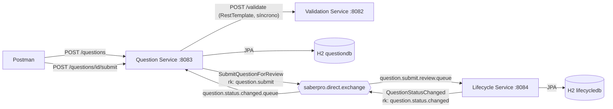
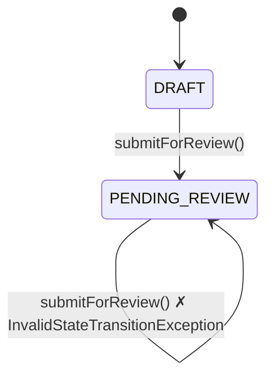
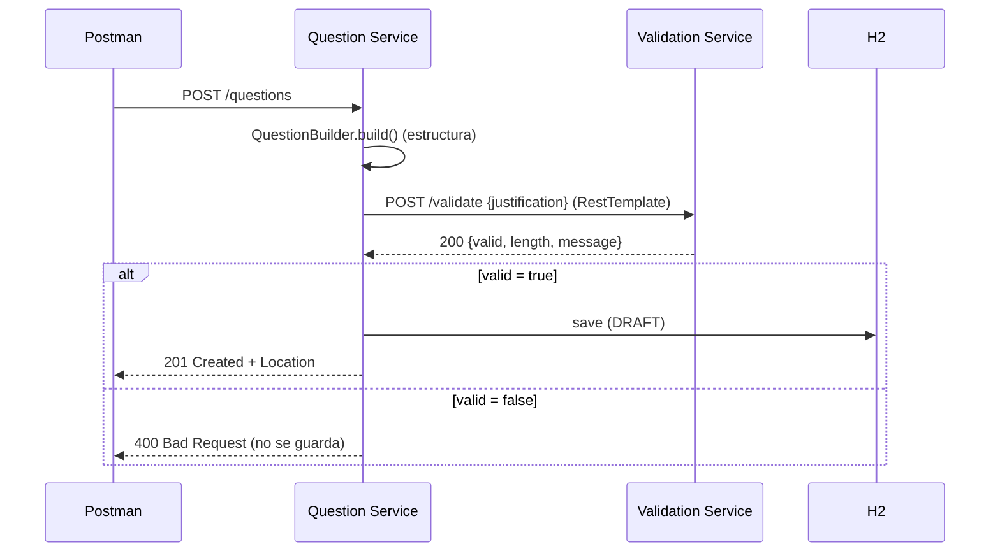
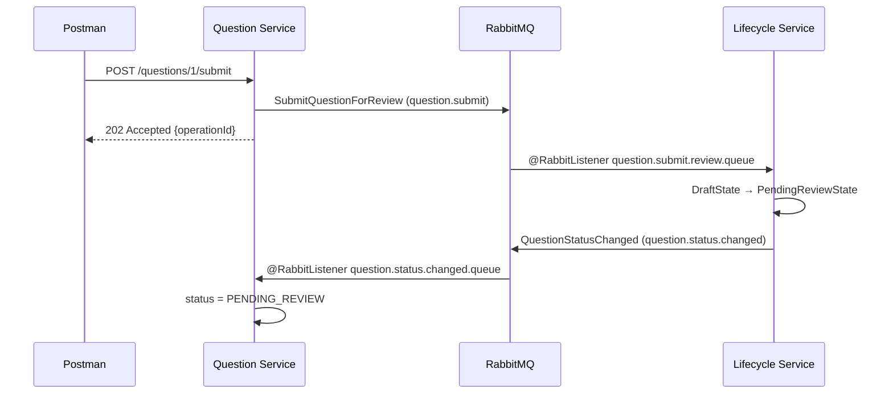
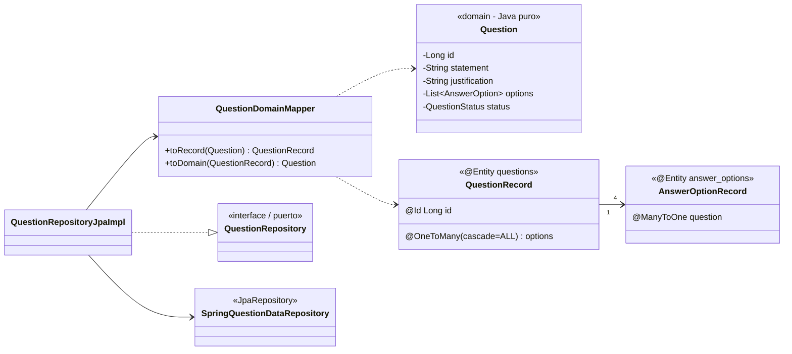

# Banco de Preguntas Saber PRO — Parcial 2 (Corte II)

**Laboratorio de Ingeniería de Software II — Universidad del Cauca — 2026.2**
**Autor:** Santiago Caicedo

Tres microservicios Spring Boot que cubren los tres puntos del parcial:

| Punto | Tema | Dónde está |
|---|---|---|
| **1.1** Builder | `IQuestionBuilder`, `QuestionBuilder` | `question-service/.../domain/builder/` |
| **1.2** State (sin `if`/`switch`) | `IQuestionState`, `DraftState`, `PendingReviewState` | `lifecycle-service/.../domain/state/` |
| **2.1** REST síncrono | `ValidationServiceRestClient` (RestTemplate) → `POST /validate` | `question-service/.../infrastructure/client/` |
| **2.2** AMQP asíncrono | `RabbitReviewCommandPublisher` → `SubmitQuestionForReviewListener` (`@RabbitListener`) | `question-service/.../messaging/`, `lifecycle-service/.../messaging/` |
| **3.1** Dominio puro | `Question` (sin `@Entity`/`@Table`/`@Id`) | `question-service/.../domain/model/` |
| **3.2** `@Entity` + `@OneToMany(cascade = ALL)` | `QuestionRecord` → `AnswerOptionRecord` | `question-service/.../infrastructure/jpa/record/` |
| **3.3** Mapper + repositorio H2 | `QuestionDomainMapper`, `QuestionRepositoryJpaImpl`, `SpringQuestionDataRepository` | `question-service/.../infrastructure/jpa/` |

---

## 1. Arquitectura



| Servicio | Puerto | Responsabilidad |
|---|---|---|
| **validation-service** | 8082 | Regla: justificación válida si tiene **más de 15 caracteres** (sin contar espacios de los extremos). |
| **question-service** | 8083 | Construye el reactivo (Builder), lo valida contra Validation Service, lo persiste en H2 y publica el comando de revisión. |
| **lifecycle-service** | 8084 | Consume el comando y ejecuta la transición `DRAFT → PENDING_REVIEW` con el patrón State. |

### Topología RabbitMQ

| Elemento | Nombre |
|---|---|
| Exchange (direct) | `saberpro.direct.exchange` |
| Cola del comando | `question.submit.review.queue` ← routing key `question.submit` |
| Cola del evento de vuelta | `question.status.changed.queue` ← routing key `question.status.changed` |

Ambos servicios declaran la misma topología (es idempotente), así que no importa cuál arranque primero.

### Decisión de diseño: ¿dónde vive el patrón State?

El enunciado (2.2) dice que **Lifecycle Service** "efectúa la transición a PENDING_REVIEW". Por eso el patrón State vive allí. Cada microservicio tiene su propia base de datos, así que después de la transición Lifecycle Service publica `QuestionStatusChanged` y Question Service actualiza su copia del estado. Así `GET /questions/{id}` muestra `PENDING_REVIEW` sin compartir la base de datos.

### Capas (arquitectura limpia / hexagonal) — Question Service

```
co.edu.unicauca.saberpro.question
├── domain                      ← Java puro, sin Spring ni JPA
│   ├── model                   Question, AnswerOption, QuestionStatus
│   ├── builder                 IQuestionBuilder, QuestionBuilder          (Punto 1.1)
│   ├── exception               DomainException, InvalidQuestionException, QuestionNotFoundException
│   └── port                    QuestionRepository (puerto de salida)
├── application                 ← casos de uso, Java puro
│   ├── QuestionService
│   ├── dto                     CreateQuestionCommand, SubmitQuestionForReview, SubmissionReceipt
│   ├── port                    JustificationValidator, ReviewCommandPublisher
│   └── exception               ValidationRejectedException, ValidationServiceUnavailableException
└── infrastructure              ← adaptadores (Spring)
    ├── rest                    QuestionController, RestExceptionHandler, dto/
    ├── client                  ValidationServiceRestClient (RestTemplate)  (Punto 2.1)
    ├── messaging               RabbitReviewCommandPublisher, QuestionStatusChangedListener (Punto 2.2)
    ├── jpa
    │   ├── record              QuestionRecord, AnswerOptionRecord (@Entity) (Punto 3.2)
    │   ├── mapper              QuestionDomainMapper                        (Punto 3.3)
    │   └── repository          SpringQuestionDataRepository, QuestionRepositoryJpaImpl (Punto 3.3)
    └── config                  ApplicationConfig, RabbitConfig, RestClientConfig, MessagingTopology
```

Lifecycle Service sigue la misma organización (`domain/state` contiene el patrón State).

Las dependencias apuntan hacia adentro: `infrastructure → application → domain`. `QuestionService` y `LifecycleService` no tienen anotaciones de Spring; se registran como beans en `ApplicationConfig`.

---

## 2. Patrones de diseño (Punto 1)

### 2.1 Builder

```java
Question q = new QuestionBuilder()
        .withStatement("¿Qué patrón encapsula estados?")
        .withJustification("El patrón State encapsula el comportamiento por estado.")
        .withOption("A", "Builder")
        .withOption("B", "State")
        .withOption("C", "Adapter")
        .withOption("D", "Facade")
        .withCorrectAnswer("B")
        .build();          // valida ANTES de crear el objeto
```

`build()` revisa y reporta **todos** los errores juntos (`InvalidQuestionException` → HTTP 400):
- enunciado y justificación no vacíos;
- **exactamente 4 opciones**, con letras únicas y textos no vacíos;
- **1 respuesta correcta** indicada que exista entre las opciones.

La longitud de la justificación (> 15) **no** se valida en el Builder: la valida Validation Service (Punto 2.1).

### 2.2 State



```java
// QuestionLifecycle (contexto): delega, no pregunta en qué estado está
public void submitForReview(String operationId) {
    state.submitForReview(this);
    ...
}

// DraftState
public void submitForReview(QuestionLifecycle ctx) { ctx.changeState(new PendingReviewState()); }

// PendingReviewState
public void submitForReview(QuestionLifecycle ctx) { throw new InvalidStateTransitionException(...); }
```

**No hay `if`/`else` ni `switch` sobre el estado.** Incluso al leer de la base de datos, el estado se reconstruye sin condicionales: cada constante del `enum QuestionStatus` sabe crear su estado (`DRAFT(DraftState::new)`, `PENDING_REVIEW(PendingReviewState::new)`).

---

## 3. Comunicación entre microservicios (Punto 2)

### 3.1 REST síncrono — `POST /questions`



| Caso | Respuesta |
|---|---|
| Justificación > 15 caracteres y estructura correcta | **201 Created**, estado `DRAFT`, cabecera `Location` |
| Justificación ≤ 15 caracteres | **400 Bad Request**, no se guarda nada |
| Estructura inválida (≠ 4 opciones, sin respuesta correcta…) | **400 Bad Request** con la lista `details` |
| Validation Service apagado | **503 Service Unavailable** |

### 3.2 AMQP asíncrono — `POST /questions/{id}/submit`



- La respuesta **202** se devuelve en cuanto se publica el mensaje, sin esperar a Lifecycle Service.
- El `operationId` permite consultar el resultado en `GET :8084/lifecycle/operations/{operationId}` (`APPLIED` o `REJECTED`).
- **Idempotencia:** si RabbitMQ entrega dos veces el mismo `operationId`, Lifecycle Service lo ignora.
- Reenviar una pregunta que ya está en revisión devuelve 202 (el comando se acepta), pero `PendingReviewState` la rechaza y la operación queda `REJECTED`.

---

## 4. Persistencia JPA limpia (Punto 3)



- `Question` (dominio) **no** tiene anotaciones JPA.
- `QuestionRecord` tiene `@OneToMany(mappedBy = "question", cascade = CascadeType.ALL, orphanRemoval = true)`: guardar la pregunta guarda sus 4 opciones.
- `QuestionDomainMapper` convierte en ambos sentidos y arma la relación bidireccional (`addOption` asigna `option.question`).
- `QuestionRepositoryJpaImpl` implementa el puerto del dominio inyectando `SpringQuestionDataRepository`.
- Base de datos H2 **en archivo**: `data/questiondb.mv.db` (y `data/lifecycledb.mv.db` para Lifecycle Service). Los datos sobreviven a los reinicios. La carpeta `data/` está en `.gitignore`; para empezar de cero se borra con `rm -rf data/` con los servicios apagados.
- Consola: <http://localhost:8083/h2-console> (JDBC URL `jdbc:h2:file:./data/questiondb`, usuario `sa`, sin contraseña).

---

## 5. Cómo ejecutarlo

### Requisitos
- **Java 21** (en este equipo: `/usr/lib/jvm/java-21-openjdk`)
- **Maven 3.9+**
- **RabbitMQ** en `localhost:5672` (guest/guest)

### 5.1 Levantar RabbitMQ

Con Docker:
```bash
docker compose up -d
```
Sin Docker (Arch Linux):
```bash
sudo pacman -S rabbitmq
sudo rabbitmq-plugins enable rabbitmq_management
sudo systemctl start rabbitmq
```
Consola: <http://localhost:15672> (guest / guest).

### 5.2 Compilar y probar
```bash
export JAVA_HOME=/usr/lib/jvm/java-21-openjdk
mvn clean install
```

### 5.3 Arrancar los servicios (una terminal por servicio)

> Ejecutar **desde la raíz del proyecto**: la base H2 se guarda en `./data/` relativo al directorio de trabajo.

```bash
mvn -pl validation-service spring-boot:run
mvn -pl question-service   spring-boot:run
mvn -pl lifecycle-service  spring-boot:run
```
o con los JAR:
```bash
java -jar validation-service/target/validation-service-1.0.0.jar
java -jar question-service/target/question-service-1.0.0.jar
java -jar lifecycle-service/target/lifecycle-service-1.0.0.jar
```

### 5.4 Datos de ejemplo
Con los tres servicios arriba:
```bash
./scripts/seed.sh
```
Crea 10 preguntas simples (matemáticas, geografía, ciencias, programación…) y envía 4 a revisión. Los datos quedan en `data/`, así que basta con correrlo una vez (si se corre de nuevo, crea duplicados).

---

## 6. Matriz de pruebas

### 6.1 Postman
Importar `postman/SaberPro-Parcial2.postman_collection.json` y ejecutarla con el **Collection Runner**, en orden. Cada petición trae sus aserciones y guarda `questionId` y `operationId` en variables.

### 6.2 curl

```bash
# 201 Created
curl -i -X POST localhost:8083/questions -H 'Content-Type: application/json' -d '{
  "statement": "¿Qué patrón GoF cambia el comportamiento según el estado interno?",
  "justification": "El patrón State encapsula cada estado en una clase.",
  "options": [
    {"label":"A","text":"Builder"}, {"label":"B","text":"State"},
    {"label":"C","text":"Adapter"}, {"label":"D","text":"Facade"}],
  "correctAnswer": "B"}'

# 400 Bad Request (justificación corta: no se guarda)
curl -i -X POST localhost:8083/questions -H 'Content-Type: application/json' -d '{
  "statement": "x", "justification": "corta",
  "options": [{"label":"A","text":"1"},{"label":"B","text":"2"},{"label":"C","text":"3"},{"label":"D","text":"4"}],
  "correctAnswer": "A"}'

# 202 Accepted + operationId
curl -i -X POST localhost:8083/questions/1/submit

# Verificar la transición
curl localhost:8083/questions/1                          # status: PENDING_REVIEW
curl localhost:8084/lifecycle/questions/1                # status: PENDING_REVIEW
curl localhost:8084/lifecycle/operations/<operationId>   # outcome: APPLIED
```

### 6.3 Evidencia en la consola de RabbitMQ
En <http://localhost:15672>:
- **Exchanges** → `saberpro.direct.exchange` con los bindings `question.submit` y `question.status.changed`.
- **Queues** → `question.submit.review.queue` con consumidor (Lifecycle Service) y gráfica de mensajes al hacer el submit.
- Para ver un mensaje en la cola: detener Lifecycle Service, hacer el submit y usar *Get messages* en la cola.

### 6.4 Pruebas automáticas (30)

| Clase | Qué verifica |
|---|---|
| `JustificationRuleTest` | Límite `> 15`: 15 falla, 16 pasa; espacios y `null`. |
| `QuestionBuilderTest` | 4 opciones exactas, respuesta correcta existente, letras únicas, todos los errores juntos. |
| `QuestionServiceTest` | Guarda solo si la validación pasa; submit publica el comando; 404 no publica. |
| `QuestionControllerTest` | Códigos HTTP 201 / 400 / 202 / 404. |
| `QuestionRepositoryJpaImplTest` | Cascada en H2, actualización sin duplicar opciones, mapeador ida y vuelta. |
| `QuestionStateTest` | Draft → PendingReview; segundo envío rechazado; reconstrucción del estado. |
| `LifecycleServiceTest` | APPLIED, REJECTED e idempotencia por `operationId`. |

---

## 7. Endpoints

| Servicio | Método | Ruta | Respuesta |
|---|---|---|---|
| Validation | POST | `/validate` | 200 `{valid, length, message}` |
| Question | POST | `/questions` | 201 / 400 / 503 |
| Question | GET | `/questions` | 200 lista |
| Question | GET | `/questions/{id}` | 200 / 404 |
| Question | POST | `/questions/{id}/submit` | 202 `{operationId, questionId, message}` / 404 / 503 |
| Lifecycle | GET | `/lifecycle/questions/{questionId}` | 200 / 404 |
| Lifecycle | GET | `/lifecycle/operations/{operationId}` | 200 `{outcome: APPLIED\|REJECTED}` / 404 |

---

## 8. Documentación del código

Cada archivo comienza con una cabecera `@file` / `@brief` / `@author`, y cada clase y método público tiene su comentario `@brief`, `@param`, `@return` y `@throws`. Para generar el sitio HTML:

```bash
doxygen Doxyfile          # → docs/doxygen/html/index.html
```
