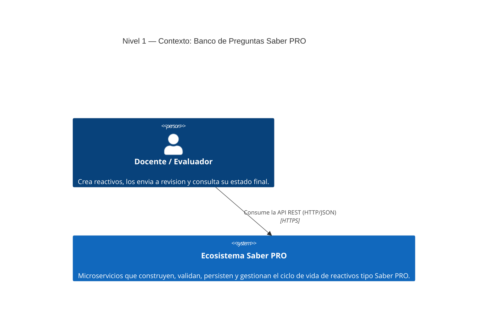
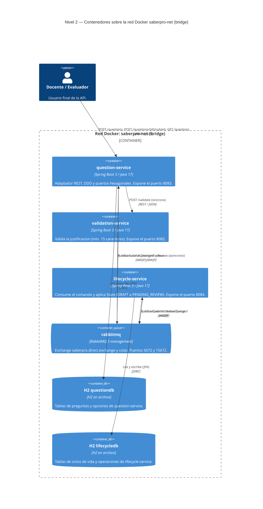
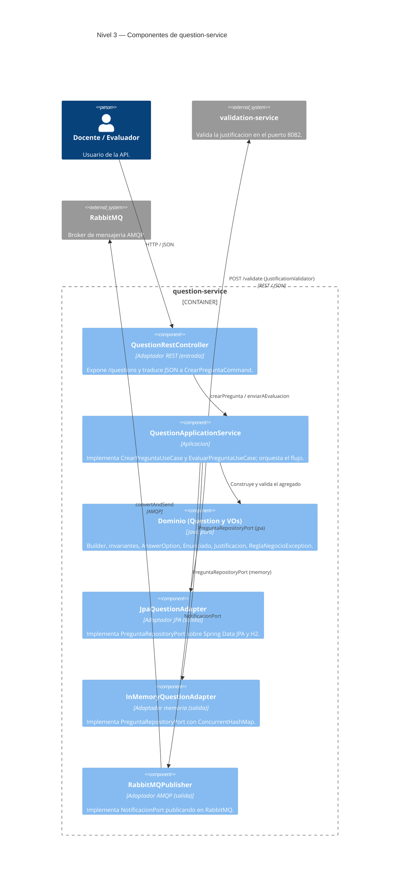
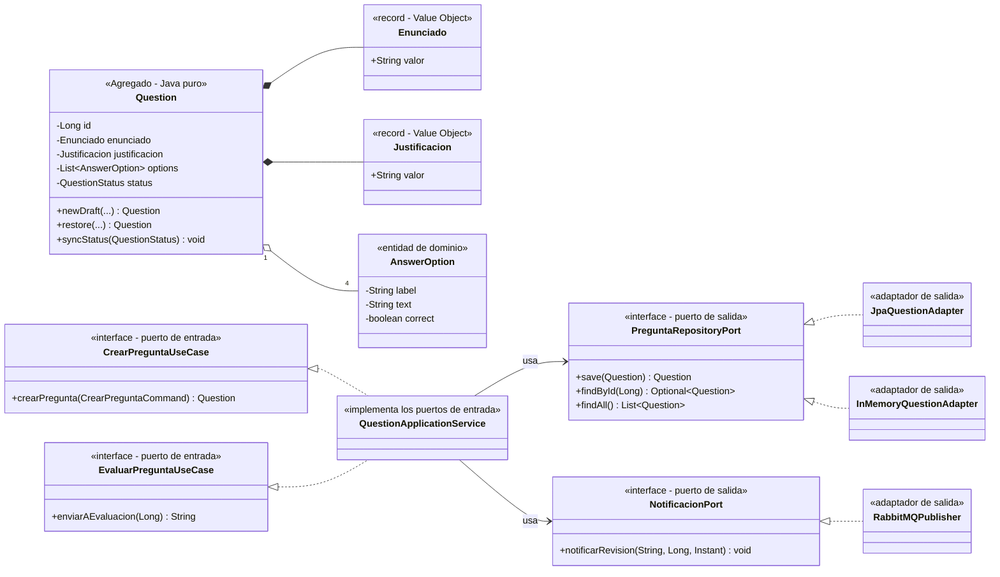
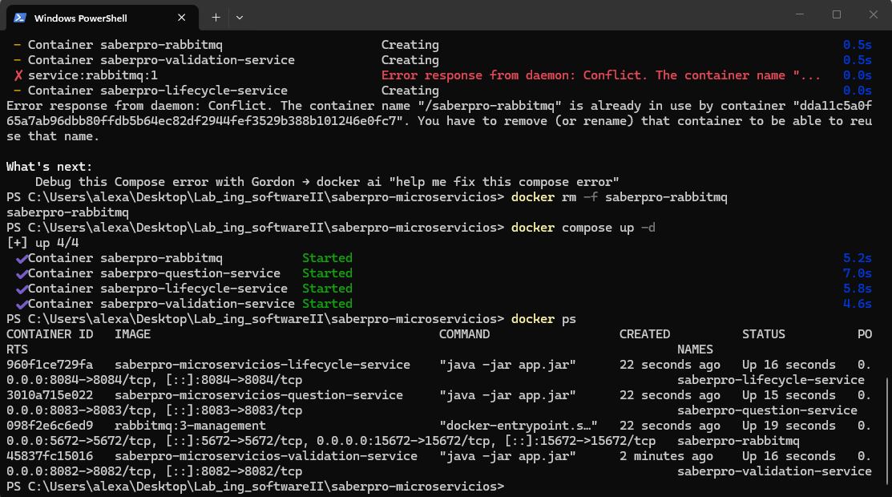
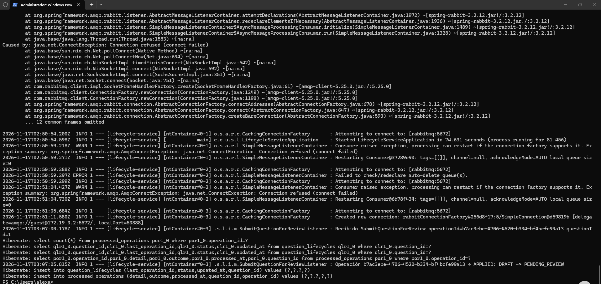

# INFORME TÉCNICO — TALLER 13: ARQUITECTURA HEXAGONAL, DDD Y MICROSERVICIOS CONTENERIZADOS (FASE II)

**Universidad del Cauca**  
Facultad de Ingeniería Electrónica y Telecomunicaciones  
Departamento de Sistemas — Programa de Ingeniería de Sistemas  
Laboratorio de Ingeniería de Software II  

- **Docente:** Ing. Paola Andrea Bedoya Toro  
- **Asignatura:** Laboratorio de Ingeniería de Software II (2026.2)  
- **Proyecto Integrador:** Banco de Preguntas Saber PRO  
- **Autores:**  
  - Santiago Caicedo  
  - Adrian Araujo  
  - Ivan Alexander López  
- **Fecha:** Popayán, Noviembre de 2026  
- **Repositorio GitHub:** [santyxswc/Lab_ing_softwareII](https://github.com/santyxswc/Lab_ing_softwareII)  
- **Pull Request de integración:** [santyxswc/Lab_ing_softwareII#1](https://github.com/santyxswc/Lab_ing_softwareII/pull/1)  

---

## 1. Evolución Arquitectónica

El **Taller 13 (Entrega Final Integradora — Fase II)** representa la convergencia de dos líneas de trabajo que hasta entonces vivían por separado:

1. El **ecosistema de microservicios** del Parcial 2 (`question-service`, `validation-service`, `lifecycle-service` y el broker **RabbitMQ**), orientado a la comunicación distribuida (REST síncrono + AMQP asíncrono).
2. Los **principios de Domain-Driven Design (DDD) y Arquitectura Hexagonal** ya validados en el módulo `banco-preguntas-hexagonal` (Taller 12 — Fase I).

El objetivo de esta fase fue **unificar ambos enfoques**: dotar al `question-service` de un núcleo de negocio puro, aislado de la tecnología, sin renunciar a la mensajería, la validación remota ni la orquestación multi-contenedor.

### 1.1 Del servicio en capas al hexágono (DDD táctico)

Antes de esta fase, `question-service` organizaba el código en capas técnicas (`controller → service → repository`). La refactorización lo reorganizó en torno al **modelo de dominio**:

- **Objetos de Valor inmutables (`record` de Java 17)** que custodian sus propias invariantes en el constructor compacto:
  - **`Enunciado`** (`domain.model.Enunciado`): no puede ser nulo ni vacío; aplica `trim()`. Si se viola, lanza `ReglaNegocioException("El enunciado no puede ser nulo ni vacío.")`.
  - **`Justificacion`** (`domain.model.Justificacion`): exige un mínimo de **15 caracteres** de sustentación técnica (`valor.trim().length() < LONGITUD_MINIMA`); si no se cumple lanza `ReglaNegocioException`.
- **Raíz del Agregado (Aggregate Root) `Question`**: encapsula `id`, `Enunciado`, `Justificacion`, `List<AnswerOption>` (lista inmutable vía `List.copyOf`) y `QuestionStatus`. Nace en `DRAFT` con `Question.newDraft(...)` (usado por el **Builder**) y se reconstruye con `Question.restore(...)` (usado por el mapeador). No tiene `@Entity`, `@Table` ni `@Id`.
- **`AnswerOption`**: opción A/B/C/D, objeto de dominio puro sin anotaciones de persistencia.
- **Excepciones de dominio**: `DomainException` (base), `ReglaNegocioException`, `InvalidQuestionException` y `QuestionNotFoundException`. El dominio señala inconsistencias semánticas sin acoplarse a HTTP.

> **Regla de dependencia respetada:** `api` / `infrastructure → application → domain`. Nada de Spring, JPA o AMQP se filtra hacia `domain`.

### 1.2 Puertos de Entrada y Salida (Arquitectura Hexagonal)

El caso de uso se expresa mediante **puertos** (interfaces) y **adaptadores** (implementaciones de infraestructura):

**Puertos de Entrada (Driving / Inbound)** — en `domain.ports.inbound`:

```java
public interface CrearPreguntaUseCase {
    Question crearPregunta(CrearPreguntaCommand command);
}

public interface EvaluarPreguntaUseCase {
    String enviarAEvaluacion(Long questionId);   // retorna el operationId
}
```

**Puertos de Salida (Driven / Outbound)** — en `domain.ports.outbound`:

```java
public interface PreguntaRepositoryPort {
    Question save(Question question);
    Optional<Question> findById(Long id);
    List<Question> findAll();
}

public interface NotificacionPort {
    void notificarRevision(String operationId, Long questionId, Instant solicitadoEn);
}
```

**Servicio de Aplicación (`QuestionApplicationService`)**: orquestador Java puro que **implementa los dos puertos de entrada** y depende **solo de puertos de salida** (`PreguntaRepositoryPort`, `NotificacionPort`) más el puerto `JustificationValidator` (hacia Validation Service). Spring lo registra como bean en `ApplicationConfig`; no lleva anotaciones propias.

### 1.3 Unificación con el ecosistema de microservicios

La Arquitectura Hexagonal se integró sin romper las dos formas de comunicación distribuidas:

| Modo | Ruta | Puerto / Adaptador |
|---|---|---|
| **REST síncrono** | `POST /questions` → `validation-service` `POST /validate` | `JustificationValidator` ← `ValidationServiceRestClient` (RestTemplate) |
| **AMQP asíncrono** | `POST /questions/{id}/submit` → RabbitMQ → `lifecycle-service` | `NotificacionPort` ← `RabbitMQPublisher` (`RabbitTemplate`) |

- El **adaptador de entrada REST** es `QuestionRestController` (`@RestController`, ruta `/questions`): traduce JSON a `CrearPreguntaCommand` y responde `201 Created` / `202 Accepted` / `400` / `404`.
- El **adaptador de salida AMQP** es `RabbitMQPublisher`, que publica `SubmitQuestionForReview(operationId, questionId, requestedAt)` en el exchange `saberpro.direct.exchange` con routing key `question.submit`.
- La **topología** (exchange, colas `question.submit.review.queue` y `question.status.changed.queue`, routing keys) está centralizada en `MessagingTopology` y es idéntica en `question-service` y `lifecycle-service`.
- El **estado** lo decide `lifecycle-service` (patrón **State**: `DRAFT → PENDING_REVIEW`). Question Service solo **replica** el resultado al consumir `QuestionStatusChanged` (`syncStatus`).

### 1.4 Intercambiabilidad de adaptadores de persistencia

El mecanismo de desacoplamiento se declara en `infrastructure.config.RepositoryAdapterConfig` y se controla por la propiedad **`saberpro.repository.adapter`**:

```java
@Configuration
public class RepositoryAdapterConfig {

    @Bean
    @ConditionalOnProperty(name = "saberpro.repository.adapter", havingValue = "jpa", matchIfMissing = true)
    public PreguntaRepositoryPort jpaQuestionAdapter(SpringQuestionDataRepository repository,
                                                     QuestionDomainMapper mapper) {
        return new JpaQuestionAdapter(repository, mapper);
    }

    @Bean
    @ConditionalOnProperty(name = "saberpro.repository.adapter", havingValue = "memory")
    public PreguntaRepositoryPort inMemoryQuestionAdapter() {
        return new InMemoryQuestionAdapter();
    }
}
```

| Valor de `saberpro.repository.adapter` | Adaptador inyectado | Tecnología |
|---|---|---|
| `jpa` (por defecto) | `JpaQuestionAdapter` | Spring Data JPA + Hibernate + H2 |
| `memory` | `InMemoryQuestionAdapter` | `ConcurrentHashMap<Long, Question>` + `AtomicLong` |

**Aspecto crítico:** el cambio de adaptador **no altera una sola línea** de `domain` ni de `application`. El hexágono permanece 100 % independiente de la tecnología de persistencia.

### 1.5 Contenerización y orquestación (Docker Compose)

Los tres microservicios y el broker se empaquetaron en contenedores y se orquestan sobre una red **bridge** común:

- **`Dockerfile` por microservicio** (uno en cada raíz: `validation-service/`, `question-service/`, `lifecycle-service/`), en dos etapas: la primera compila el `.jar` ejecutable con Maven y la segunda lo corre sobre Java 17 con `ENTRYPOINT ["java", "-jar", "app.jar"]`. La guía indica la base `openjdk:17-jdk-slim`; como Docker Hub retiró esa etiqueta, se usa su reemplazo oficial `eclipse-temurin:17-jre-jammy` (parametrizable con `RUNTIME_IMAGE`).
- **`docker-compose.yml`** en la raíz del repositorio (incluye el de `saberpro-microservicios/`, donde se definen los 4 servicios) sobre la red `saberpro-net`, con *healthcheck* del broker, `depends_on`, volúmenes para las bases H2 y variables de entorno para el descubrimiento por nombre de servicio.
- **Un solo comando**: `docker compose up -d --build` compila y ejecuta todo el ecosistema, sin Java ni Maven en la máquina.
- **Puertos públicos**: `8082`, `8083`, `8084`, `5672` y `15672`, para las pruebas con Postman o Thunder Client.

```bash
docker compose up -d --build       # compila los .jar, construye imágenes y levanta los 4 contenedores
docker compose ps                  # estado de los contenedores
docker compose logs -f question-service
docker compose down                # detiene y elimina los contenedores
```

---

### 1.6 Encarpetado oficial del proyecto

El código sigue la estructura de paquetes de la guía del taller:

| Microservicio | Paquete | Contenido |
|---|---|---|
| `validation-service` (:8082) | `validation.api` | `ValidationRestController` |
| `question-service` (:8083) | `question.domain.model` | `Question`, `AnswerOption`, `Enunciado`, `Justificacion` (Java puro) |
| | `question.domain.exception` | `ReglaNegocioException` |
| | `question.domain.ports.inbound` | `CrearPreguntaUseCase`, `EvaluarPreguntaUseCase` |
| | `question.domain.ports.outbound` | `PreguntaRepositoryPort`, `NotificacionPort` |
| | `question.application` | `QuestionApplicationService` |
| | `question.infrastructure.jpa` | `QuestionRecord`, `QuestionDomainMapper`, `JpaQuestionAdapter` |
| | `question.infrastructure.memory` | `InMemoryQuestionAdapter` |
| | `question.infrastructure.messaging` | `RabbitMQPublisher` |
| | `question.api` | `QuestionRestController` |
| `lifecycle-service` (:8084) | `lifecycle.messaging` | `QuestionReviewListener` |

La intercambiabilidad se comprueba con una prueba de contrato (`PreguntaRepositoryPortContract`): las mismas
aserciones se ejecutan contra `InMemoryQuestionAdapter` y contra `JpaQuestionAdapter` sin cambiar una línea.

### 1.7 Matriz de trazabilidad del proyecto semestral

| Corte | Enfoque arquitectónico | Hitos técnicos | Dónde está en el repositorio | Ponderación |
|---|---|---|---|---|
| Corte I | Monolito limpio y SOLID | Refactorización SOLID, capas MVC, pipeline de validación HU03 (Pipes & Filters) y soporte de plugins (Microkernel) | `banco-preguntas-microkernel/`, `productos-api/` | 25% |
| Corte II | Microservicios y GoF | Bounded Contexts autónomos, REST síncrono, eventos AMQP con RabbitMQ, patrones Builder, State y Adapter, JPA | `saberpro-microservicios/` (Parcial 2) | 35% |
| Corte III | DDD, Hexagonal y Docker | Dominio puro en Java, puertos y adaptadores, intercambiabilidad InMemory vs JPA, `Dockerfile` y Docker Compose | `banco-preguntas-hexagonal/` (Taller 12) y `saberpro-microservicios/` + `docker-compose.yml` (Taller 13) | 40% |

## 2. Modelo C4 Completo (Mermaid)

### 2.1 Nivel 1 — Contexto del Sistema



### 2.2 Nivel 2 — Contenedores (red Docker `saberpro-net`)



### 2.3 Nivel 3 — Componentes internos de `question-service`



### 2.4 Nivel 4 — Diagrama de Código (clases e interfaces)



---

## 3. Evidencias de Despliegue y Pruebas End-to-End

Las capturas se almacenan en [`saberpro-microservicios/docs/evidencias/`](evidencias/). Cada una corresponde a un momento del flujo contenerizado y de la comunicación distribuida.

| # | Archivo | Qué demuestra |
|---|---|---|
| 01 | `01-docker-ps.png` | Orquestación de los **4 contenedores** (`saberpro-rabbitmq`, `saberpro-validation-service`, `saberpro-question-service`, `saberpro-lifecycle-service`) tras `docker compose up -d`, con sus puertos y estado `Up`. |
| 02 | `02-pruebas-rest.png` | Ciclo REST completo contra `question-service`: consulta `200 OK`, creación `201 Created` en estado `DRAFT`, rechazo de invariante `400 Bad Request` y envío asíncrono `202 Accepted` con `operationId`. |
| 03 | `03-rabbitmq-queues.png` | Colas `question.submit.review.queue` y `question.status.changed.queue` activas en la consola de RabbitMQ, con sus consumidores y bindings en `saberpro.direct.exchange`. |
| 04 | `04-lifecycle-logs.png` | Logs de `lifecycle-service`: consumo idempotente del comando y transición de estado aplicada (`APPLIED: DRAFT -> PENDING_REVIEW`). |

### 3.1 01 — Orquestación de contenedores

`docker compose up -d` levanta RabbitMQ y los tres microservicios sobre la red `saberpro-net`; todos los servicios publican sus puertos en el host (`8082`, `8083`, `8084`) y el broker expone AMQP (`5672`) y su consola (`15672`).



### 3.2 02 — Pruebas REST end-to-end (200, 201, 400, 202)

Se comprueban los cuatro códigos de estado exigidos:

- **`200 OK`** — `GET /questions/{id}` devuelve la pregunta consultada.
- **`201 Created`** — `POST /questions` con estructura correcta y justificación válida (`> 15` caracteres) persiste el reactivo en estado `DRAFT` y devuelve cabecera `Location`.
- **`400 Bad Request`** — se viola una invariante de dominio (justificación con menos de 15 caracteres → `ReglaNegocioException`, o estructura inválida con distinto número de opciones): **no se guarda nada**.
- **`202 Accepted`** — `POST /questions/{id}/submit` publica `SubmitQuestionForReview` en RabbitMQ y responde de inmediato con un `operationId`.


### 3.3 03 — Topología de colas en RabbitMQ

En `http://localhost:15672` se observan el exchange directo `saberpro.direct.exchange`, la cola `question.submit.review.queue` (consumida por `lifecycle-service`) y la cola `question.status.changed.queue` (consumida por `question-service`), con sus routing keys `question.submit` y `question.status.changed`.


### 3.4 04 — Consumo idempotente y transición de estado

Los logs de `lifecycle-service` evidencian el consumo del comando, el manejo de reentregas (idempotencia por `operationId`) y la transición aplicada por el patrón **State**:

```text
Recibido SubmitQuestionForReview operationId=<uuid> questionId=1
Operación <uuid> → APPLIED: DRAFT -> PENDING_REVIEW
```



---

## 4. Conclusiones

1. **Unificación exitosa:** el ecosistema de microservicios (REST + AMQP + Docker Compose) y la Arquitectura Hexagonal/DDD coexisten sin fricción; el hexágono se aísla en `question-service` mientras `validation-service` y `lifecycle-service` mantienen sus responsabilidades.
2. **Negocio protegido:** las invariantes (`Enunciado` no vacío, `Justificacion` ≥ 15 caracteres) viven en el dominio y se traducen a `400 Bad Request` mediante `RestExceptionHandler`, sin que el dominio conozca HTTP.
3. **Intercambiabilidad real:** `JpaQuestionAdapter` y `InMemoryQuestionAdapter` se sustituyen con una sola propiedad (`saberpro.repository.adapter`), demostrando que la tecnología de persistencia es un detalle de infraestructura.
4. **Reproducibilidad:** la contenerización y la orquestación con `docker compose` permiten levantar todo el ecosistema con un único comando, con descubrimiento por nombre de servicio en la red `saberpro-net`.

---

## 5. Enlaces y Referencias

- **Repositorio GitHub:** [santyxswc/Lab_ing_softwareII](https://github.com/santyxswc/Lab_ing_softwareII)
- **Pull Request de integración:** [santyxswc/Lab_ing_softwareII#1](https://github.com/santyxswc/Lab_ing_softwareII/pull/1)
- **Módulo del Taller 13:** `saberpro-microservicios/`
- **Informe de la Fase I (Taller 12):** [`banco-preguntas-hexagonal/docs/INFORME_TECNICO.md`](../../banco-preguntas-hexagonal/docs/INFORME_TECNICO.md)
- **README del módulo:** [`saberpro-microservicios/README.md`](../README.md)
- **Integración Continua (GitHub Actions CI):** `.github/workflows/ci.yml`
